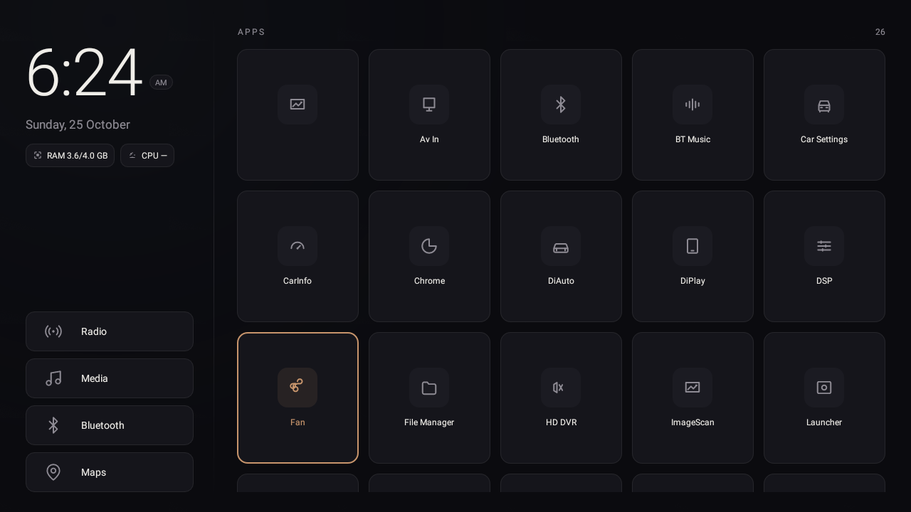

# Flat Launcher for 8227L Head Unit

A custom, minimal home screen (launcher) for cheap Android 8.1 car head units (8227L / MT8227L class hardware), plus the debloat and tuning notes from the full setup. Designed first on the [pencil.dev](https://pencil.dev) canvas (`design/hud design.pen`), then implemented with **zero dependencies**: no Gradle, no AndroidX, no Compose. Just framework views and a 40-line build script.



## The hardware it targets

| | |
|---|---|
| Unit | 8227L demo (MediaTek alps, HCN/AutoChips vendor stack) |
| Android | 8.1.0 (API 27) |
| Screen | 1280 x 720 @ 160dpi, landscape |
| ABI | armeabi-v7a |
| RAM | 4 GB (about 3.4 GB of it is page cache on this kernel; see notes) |

## What it looks like

The screen has two zones:

- **Left rail (300dp):** a large thin clock (follows the system 12/24h setting, AM/PM pill in 12h mode), the date, two live chips with RAM used/total and CPU usage, then four pinned car shortcuts at the bottom: Radio, Media, Bluetooth, Maps.
- **Right (everything else):** an "APPS" header with a live count, and a 5-column grid of oversized tiles (about 3 rows visible, scrollable). Each tile is a dark card with an icon plate and a label.

Color system (also saved as variables in the .pen file):

| Role | Value |
|---|---|
| Background | `#0B0B0F` with a faint radial glow |
| Surface | `#15151B` |
| Icon plate | `#1B1B22` |
| Hairline | `#26262B` |
| Text | `#F0EEE9` |
| Muted | `#8E8B94` |
| Accent (press, last-used, highlight) | `#C8956C` muted amber |

## Features over the stock launcher3

- **Flat glyph icons for everything.** Every app on the unit is mapped to a hand-drawn vector glyph (map pin, play triangle, globe, gear, folder, audio bars, BT rune, camera, car, gauge, fan, steering wheel, and so on). Apps that are not in the mapping (for example something you install from the Play Store later) automatically get a neutral generic glyph. The grid never shows a colorful default app icon.
- **Live system stats.** RAM used/total from `ActivityManager.MemoryInfo` (system view, matches `adb shell dumpsys meminfo`), CPU from `/proc/stat` deltas with a `/proc/loadavg` fallback. On this particular firmware both CPU sources are denied to apps, so the CPU chip shows "—" until the ROM allows it (the code activates by itself when it can).
- **Last-used highlight.** The app you launched most recently gets the amber stroke, plate, and label. Persisted in prefs, keyed per activity so two apps from one package (Bluetooth vs BT Music) highlight independently.
- **Restart tile.** A pseudo-app at the end of the grid. Tap it, get a confirmation prompt, confirm, and the launcher attempts `PowerManager.reboot()`. Normal apps are not allowed to reboot on stock Android, so if the firmware blocks it the dialog says so and points at the ignition instead of failing silently.
- **Live package refresh.** A receiver for `PACKAGE_ADDED / REMOVED / REPLACED` plus a requery in `onStart()` catches installs that happened while the launcher was stopped. Install or uninstall an app and the grid updates instantly, no relaunch.
- **Per-activity launches.** Grid tiles launch their exact activity, not the package default. "BT Music" opens the BT Music source app, "Bluetooth" opens the Bluetooth phone UI.
- **BACK is absorbed.** On this firmware the hardware BACK key on a home screen triggers a system slide-down overlay that cannot be dismissed under immersive mode. A launcher has no back semantics, so `onBackPressed()` is empty and the whole class of problem disappears.
- **Immersive fullscreen**, no status bar, no navigation bar, no wallpaper, no widgets, no feed, no dock.
- **Long-press any tile** for the app info dialog.

## Performance

| Metric | Stock launcher3 | Flat launcher |
|---|---|---|
| PSS (dumpsys meminfo) | 53.8 MB | **24.1 MB** |
| Cold start (am start -W, ThisTime) | - | ~0.7 s |
| Permissions | many | **none** |
| External dependencies | - | **none** |

## Repository layout

```
launcher/
  AndroidManifest.xml          HOME activity, no permissions
  build.sh                     aapt2 -> javac -> d8 -> zip -> zipalign -> apksigner
  java/com/headunit/flatlauncher/
    FlatActivity.java          UI wiring, receivers, restart prompt, stats tick
    AppGridAdapter.java        package query, per-activity intents, glyph mapping
    SystemStats.java           RAM via ActivityManager, CPU via /proc
  res/
    layout/                    activity_flat.xml, grid_item.xml
    drawable/                  chips, tiles, plates, divider, 25+ vector glyphs
    values/                    colors, dimens, strings, theme
design/
  hud design.pen               the original pencil.dev design
  flat-launcher-home.png       screenshots
docs/
  specs/                       design spec (approved before implementation)
  plans/                       task-by-task implementation plan
  DISABLED_PACKAGES.txt        every package disabled during debloat, with restore commands
```

## Building

Requirements: JDK 17, Android SDK with build-tools 35.x and any platform jar (android-30+ works; the app only uses API 27 surface).

```sh
cd launcher
./build.sh
```

The script generates a debug keystore on first run (`launcher/keystore/`, gitignored), compiles, dexes, aligns, and signs. Output: `launcher/dist/flatlauncher.apk`.

## Installing

```sh
adb install -r launcher/dist/flatlauncher.apk
adb shell cmd package set-home-activity com.headunit.flatlauncher/.FlatActivity
```

Important on this firmware: **updating the launcher clears the default-home preference.** After every `adb install -r`, run the `set-home-activity` line again. If HOME ever opens something else, that is why.

The stock launcher3 is left installed and launchable from the grid as a fallback.

## Debloat summary (the rest of this repo's story)

88 packages were disabled with reversible `pm uninstall -k --user 0` operations: 57 vendor theme APKs, Netflix, the Google app, firmware OTA updaters, MediaTek loggers and engineering tools, wallpaper/easter-egg leftovers. Full list with per-package restore commands: `docs/DISABLED_PACKAGES.txt`. Every APK was backed up first.

Other tuning: animations at 0.5x, background-restricted YouTube/Chrome/Maps/Play via appops, caches trimmed, and a reboot.

Measured effect: the roughly 110 MB of always-running background processes (Google app `:search` at 53 MB, background YouTube at 49 MB, and friends) cannot come back. MemAvailable at idle is about 0.4 GB because this MTK kernel keeps about 3.4 GB as page cache and refuses to promise it; `dumpsys meminfo` shows the real userspace usage is around 0.65 GB.

## Firmware quirks discovered along the way (documented so you don't re-debug them)

1. **BT music routing.** A2DP audio only outputs while the AutoChips BT Music source app (`com.autochips.bluetooth/.BtMusicActivity`) is the active source. The phone pairs and streams fine, but the stream is parked (0 active tracks in the mixer) until BT Music is opened. An earlier build auto-opened BT Music on phone connect; that was removed as annoying. Current behavior: open BT Music from the grid, then play from the phone.
2. **`/proc` per-UID lies.** Apps read a different `/proc/meminfo` than shell on this kernel (2.7 GB "available" inside the app vs 0.36 GB from adb). That is why RAM comes from `ActivityManager` and not `/proc`.
3. **CPU stats denied.** `/proc/stat` and `/proc/loadavg` are both blocked for apps. No root, no system-wide CPU percent.
4. **adb over wifi is not persistent.** `persist.adb.tcp.port` cannot be set without root, and adbd restarts drop the TCP listener. After a power cycle you have to re-enable it (USB cable once, or the unit's debug toggle). The unit's DHCP address also wanders; reserve `20:f1:b2:...` in your router.
5. **The vision tooling used to "analyze" screenshots hallucinated entire UIs.** All on-device verification in this project was done with `uiautomator dump` (exact text and bounds), `dumpsys`, and screencaps for human eyes.

## Rollback

- Launcher: `adb shell pm uninstall -k --user 0 com.headunit.flatlauncher`, or switch the default home in Settings. launcher3 is untouched.
- Any disabled package: `adb shell cmd package install-existing <package>` (see `docs/DISABLED_PACKAGES.txt`).

## Credits

- DiPlay (CarPlay receiver) and DiAuto (Android Auto receiver) are third-party GPL/AGPL projects by shihabal3amri and are NOT included in this repo. Their APKs were installed from official GitHub releases.
- The launcher itself: plain hand-written code, no third-party libraries.
